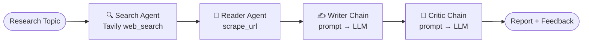

# ResearchMind 🔬

**A multi-agent AI research system that searches, reads, writes, and critiques — then hands you a finished report.**

Give it any topic. Four specialized stages built on LangChain run in sequence: one searches the web, one scrapes the most relevant page, one drafts a structured report, and one grades it. The output is a markdown report you can download, plus honest editorial feedback on how good it actually is.


---

## Features

- **Four-stage pipeline** — search → scrape → write → critique, each with a single clear responsibility.
- **Real web grounding** — live Tavily search results plus cleaned text scraped from the top URL, not just model memory.
- **Structured reports** — every report follows Introduction → Key Findings → Conclusion → Sources.
- **Built-in self-review** — a critic chain scores the report out of 10 and lists concrete weaknesses.
- **Two interfaces** — a polished Streamlit app and a plain command-line runner.
- **Downloadable output** — export the finished report as a `.md` file straight from the UI.

---

## Architecture



| # | Stage | Kind | Tool | Produces |
|---|-------|------|------|----------|
| 01 | **Search Agent** | Tool-calling agent | `web_search` (Tavily, 5 results) | Titles, URLs, snippets |
| 02 | **Reader Agent** | Tool-calling agent | `scrape_url` (requests + BeautifulSoup) | Clean page text (first 3,000 chars) |
| 03 | **Writer Chain** | Prompt → LLM → text | — | Full research report |
| 04 | **Critic Chain** | Prompt → LLM → text | — | Score, strengths, improvements, verdict |

The two agents can decide *how* to call their tool; the two chains are fixed prompt templates, so their output format is predictable.

---

## Project structure

```
.
├── app.py            # Streamlit UI — hero layout, live pipeline status, report download
├── pipeline.py       # CLI entry point — runs the same four stages in a terminal
├── agents.py         # Model setup, agent builders, writer & critic prompt chains
├── tools.py          # LangChain tools: Tavily search + BeautifulSoup scraper
├── requirements.txt  # Pinned dependency floors
└── .gitignore        # Excludes .env
```

---

## Getting started

### 1. Prerequisites

- Python 3.10 or newer
- An [OpenAI API key](https://platform.openai.com/api-keys)
- A [Tavily API key](https://tavily.com) (free tier available) for web search

### 2. Clone and install

```bash
git clone https://github.com/TXsShadowFox/Multi-Agent-Research-System.git
cd Multi-Agent-Research-System

python -m venv .venv
# Windows
.venv\Scripts\activate
# macOS / Linux
source .venv/bin/activate

pip install -r requirements.txt
```

### 3. Configure keys

Create a `.env` file in the project root (it is git-ignored):

```env
OPENAI_API_KEY=sk-...
TAVILY_API_KEY=tvly-...
```

Both are read automatically via `python-dotenv`.

### 4. Run it

**Streamlit app** — the recommended experience:

```bash
streamlit run app.py
```

Then open the URL it prints (usually `http://localhost:8501`), type a topic, and hit **Run Research Pipeline**.

**Command line** — no UI, just output:

```bash
python pipeline.py
```

You'll be prompted for a topic and the four stages print as they complete.

---

## How it works

**Search.** The search agent receives a natural-language instruction and calls `web_search`, which queries Tavily for the five most relevant results. It formats each as `Title / URL / Snippet` blocks separated by dividers.

**Read.** The reader agent is handed the first 800 characters of those results and chooses a single URL to scrape. `scrape_url` fetches the page, strips `script`, `style`, `nav`, and `footer` tags, and returns up to 3,000 characters of readable text. Failures degrade gracefully into an error string rather than crashing the run.

**Write.** The search output and scraped text are concatenated into a research block and passed to the writer prompt, which enforces a fixed structure: Introduction, at least three well-explained Key Findings, a Conclusion, and a Sources list of every URL found.

**Critique.** The finished report goes to the critic prompt, which returns a 10-point score, strengths, areas to improve, and a one-line verdict.

The Streamlit app mirrors this flow step by step, updating a status card per stage and caching each result in session state so the progress display survives re-renders.

---

## Configuration

| What | Where |
|---|---|
| Model and temperature | `agents.py` line 11 — `ChatOpenAI(model="gpt-4o-mini", temperature=0)` |
| Report structure | `writer_prompt` in `agents.py` |
| Critique rubric | `critic_prompt` in `agents.py` |
| Number of search results | `max_results=5` in `tools.py` |
| Scrape length cap | `[:3000]` in `tools.py` |

Swapping models is a one-line change, provided the replacement is available through `langchain-openai`. To use a different provider, replace the `ChatOpenAI` import with the corresponding LangChain integration.

---

## Known limitations

- **Single-page depth.** The reader scrapes one URL per run, so claims outside that page rely on search snippets alone.
- **Truncation.** Pages are cut at 3,000 characters; the reader also sees only the first 800 characters of search output when choosing what to scrape.
- **No citations verification.** The Sources section lists URLs found in the research, but no stage confirms each claim maps to a specific source.
- **No persistence.** Nothing is cached or stored; every run re-executes all four stages and Streamlit state resets on restart.
- **No retry logic.** Transient API or network failures surface as errors rather than being retried, despite `tenacity` being listed in requirements.

---

## Acknowledgements

Forked from [AkarshVyas/Multi-agent-research-system](https://github.com/AkarshVyas/Multi-agent-research-system). Thanks to the original author for the pipeline design.

Built with [LangChain](https://www.langchain.com), [Streamlit](https://streamlit.io), [Tavily](https://tavily.com), and [OpenAI](https://openai.com).

---

## License

No license file is included in this repository. Add one before distributing or reusing this code publicly.
